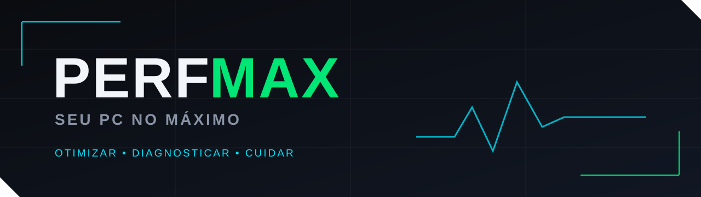

<div align="center">



<br>

[](../../releases/latest/download/PerfMax-Setup.exe)

[](../../releases/latest)


**[🌐 tiosilvaa.com/max](https://tiosilvaa.com/max)** · **[Novidades](CHANGELOG.md)** · **[Perguntas frequentes](FAQ.md)** · **[Ajuda](SUPPORT.md)** · **[Reportar um problema](../../issues/new/choose)**

</div>

---

## O que é

O **PerfMax** é um aplicativo para Windows que ajuda a otimizar, diagnosticar e cuidar do PC, em um só lugar.

<table>
<tr>
<td width="33%" valign="top">

### 🎮 Jogos
Ajustes para jogar, perfis por jogo e guias de configuração gráfica.

</td>
<td width="33%" valign="top">

### 🤖 Assistente
Tire dúvidas e descreva problemas em português. Ele investiga com dados do seu PC e oferece correções com a sua confirmação.

</td>
<td width="33%" valign="top">

### 🌐 Internet
Teste de velocidade, ping e diagnóstico da conexão.

</td>
</tr>
<tr>
<td valign="top">

### 🔎 Perícia do Windows
Examina inicialização, discos, drivers e falhas, e mostra o que encontrou.

</td>
<td valign="top">

### ↩️ Desfazer
Os ajustes do catálogo guardam o valor anterior para você voltar atrás.

</td>
<td valign="top">

### 🧩 Sem driver de kernel
O PerfMax não instala driver de kernel próprio.

</td>
</tr>
</table>

## Como instalar

1. Clique em **[Baixar o PerfMax](../../releases/latest/download/PerfMax-Setup.exe)**.
2. Abra o arquivo `PerfMax-Setup.exe`.
3. Siga o instalador. Algumas funções pedem permissão de administrador.

> [!NOTE]
> O instalador ainda não tem assinatura digital. Por isso o Windows pode mostrar o aviso **"O Windows protegeu o computador"**.
> Antes de continuar, confirme que baixou o arquivo **desta página** e [confira o SHA-256](#conferir-o-arquivo).

## Conferir o arquivo

No PowerShell, na pasta do download:

```powershell
Get-FileHash .\PerfMax-Setup.exe -Algorithm SHA256
```

O resultado precisa ser igual ao publicado na página da [versão](../../releases/latest).

## Requisitos

| | |
|---|---|
| **Sistema** | Windows 10 ou 11, 64 bits |
| **Internet** | Para o Assistente, atualizações e a conta |

## Planos

O app tem uso gratuito e plano **Pro**. No gratuito, o Assistente tem um limite diário de perguntas. Valores e detalhes atuais estão no **[site](https://tiosilvaa.com/max)**.

## 💚 Apoie o projeto

<div align="center">

[](https://livepix.gg/tiosilvaa)
[-00B8D4?style=for-the-badge&labelColor=0A0C10)](https://buy.stripe.com/bJecN50Ry5Dhe01e1WaEE00)

</div>

São os **únicos** meios de doação, os mesmos do site. Doação é voluntária e **não** libera o plano Pro nem créditos. [Saiba mais](SUPPORT.md#apoiar-o-projeto).

## 🔒 Baixe com segurança

Os lugares oficiais são **este repositório** e **[tiosilvaa.com/max](https://tiosilvaa.com/max)**. Não baixe o PerfMax de outros sites.

## Dúvidas e problemas

Abra um **[chamado](../../issues/new/choose)** contando o que você fez, o que esperava e o que aconteceu.
**Não envie** keys, senhas, e-mails ou outros dados pessoais: os chamados são públicos.

---

<div align="center">
<sub><a href="https://tiosilvaa.com/privacidade">Privacidade</a> · <a href="https://tiosilvaa.com/termos">Termos</a> · <a href="https://tiosilvaa.com/contato">Contato</a></sub><br>
<sub>© TioSilvaa. Todos os direitos reservados. Este repositório distribui apenas o instalador; o código-fonte não é público.</sub>
</div>
